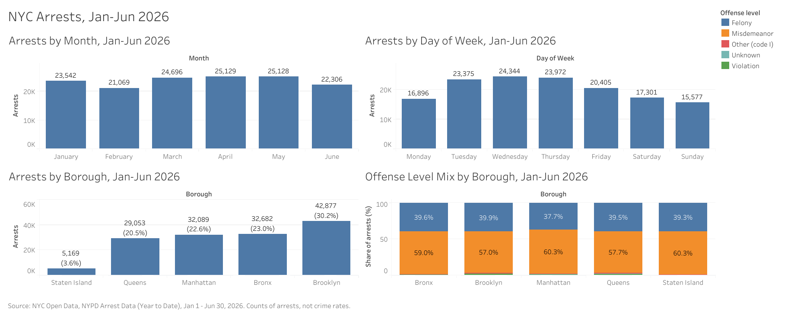

# NYC Arrest Data Analysis (Jan-Jun 2026)

SQL analysis of 141,870 NYPD arrest records from January 1 to June 30, 2026, covering when arrests happen, where, and for what categories of offense.

**Tools:** SQLite (DB Browser for SQLite), SQL, Tableau Public

**Dashboard:** [NYC Arrests, Jan-Jun 2026 (Tableau Public)](https://public.tableau.com/app/profile/mario.guerrero/viz/NYCArrestsJan-Jun2026/NYCArrestsJan-Jun2026)

**Queries:** `nypd_arrests_starter.sql`

## Data source

NYC Open Data, *NYPD Arrest Data (Year to Date)*, provided by the NYPD. The file I used covers Jan 1 - Jun 30, 2026 (141,870 rows, one row per arrest, no duplicate arrest keys).

## Questions

1. How do arrests change by month and day of week?
2. Which boroughs and precincts have the most arrests?
3. What is the felony / misdemeanor / violation mix in each borough?
4. What are the most common offense categories, and do they differ by borough?
5. How are arrests split across Patrol, Transit, and Housing?

## Key findings

**Timing**
- Monthly arrests ranged from 21,069 (Feb) to 25,129 (Apr). Adjusted for days in the month, April was highest (~838 per day) and June was lowest (~744 per day).
- Wednesday had the highest daily average (~974) and Sunday the lowest (~599). Monday (~650) looked closer to the weekend days than to Tuesday-Thursday. I did not investigate why.

**Location**
- Brooklyn had the most arrests (42,877, 30.2%), followed by the Bronx (23.0%), Manhattan (22.6%), Queens (20.5%), and Staten Island (3.6%).
- The 10 precincts with the most arrests accounted for 38,472 arrests (about 27% of the total). Precinct 75 had the most (5,341).

**Offense level and category**
- Misdemeanors were 58.5% of arrests and felonies 39.2%. The mix was similar across boroughs (felonies 37.7%-39.9%).
- The most common offense category was Assault 3 & Related Offenses (20,106, 14.2%), followed by Petit Larceny and Felony Assault. Assault 3 was the top category in four of five boroughs; in Manhattan, Petit Larceny was first.

**Jurisdiction**
- Patrol 84.1%, Transit 10.1%, Housing 3.4%, and other (non-NYPD) 2.5%.

## Data quality

- No duplicate arrest keys; every borough code was valid; no missing latitude values.
- About 0.9% of arrests (1,295) had a blank, null, or undocumented offense-level code (blank, `(null)`, or `9`). I grouped these as Unknown and kept them in the data. A further 99 used the code `I`, which is not documented in the footnotes, so I kept it as its own group.
- 24 arrests had no offense description and 5 had no law code.
- 936 arrests carried placeholder law codes (LOC0000-type), which the dataset footnotes say represent violations of Transit Rules and Regulations and other such categories.
- Two offense category names (Criminal Mischief & Related Of..., Offenses Against Public Admini...) appear truncated in the source data.

## Limitations

- **Arrests are not crime.** This data records police enforcement activity. The footnotes state it is not comparable to FBI crime statistics.
- **Counts are not rates.** I did not adjust for population, so these results do not show that any borough or precinct is more or less safe.
- **Locations are approximate.** Per the footnotes, arrests are placed at intersections or street midpoints, and some at station houses.
- **Six months only.** Results cover Jan-Jun 2026 and may not represent the full year.
- I did not analyze age, sex, or race fields. Without population data, counts by demographic group cannot support conclusions.
- No time-of-day analysis was possible: the dataset has a date but no time.

## How to reproduce

1. Download the CSV from NYC Open Data and import it into SQLite as a table named `arrests`.
2. Run the queries in `nypd_arrests_starter.sql` in order.
